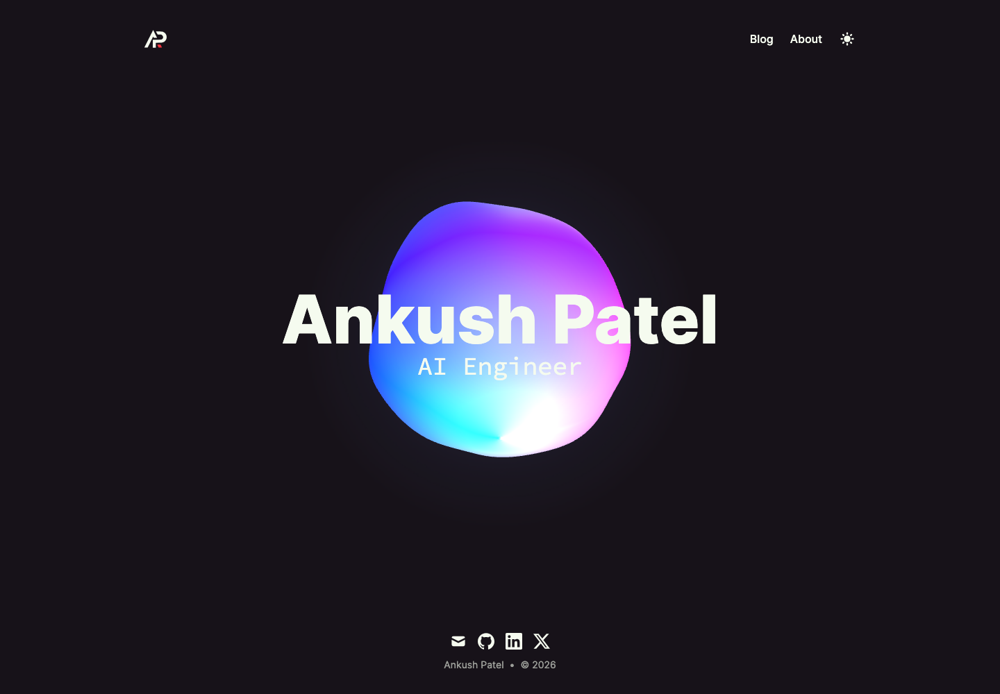
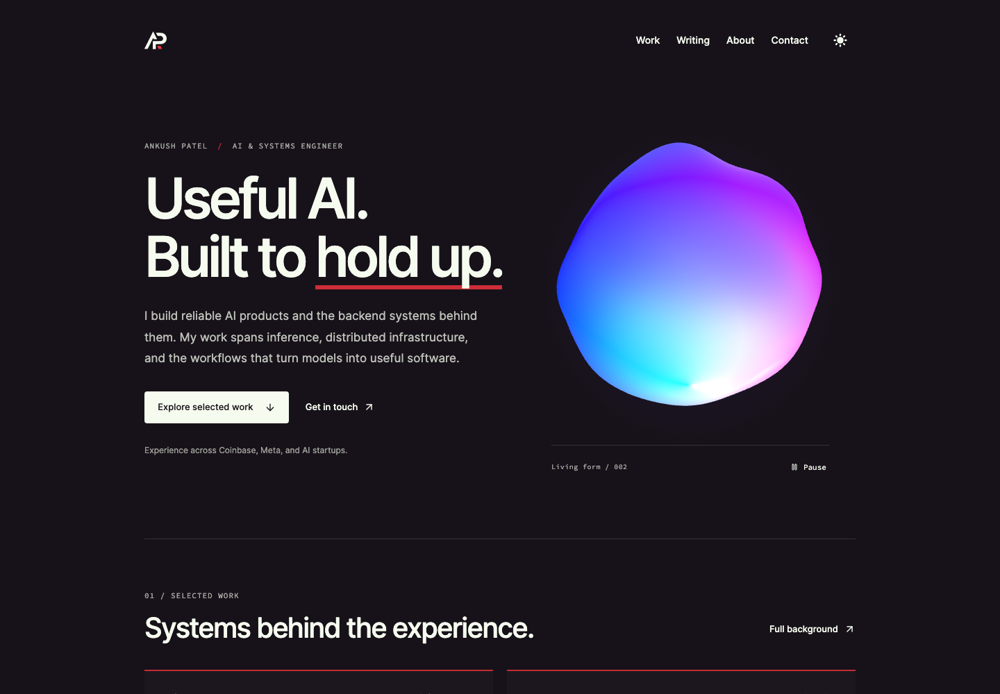
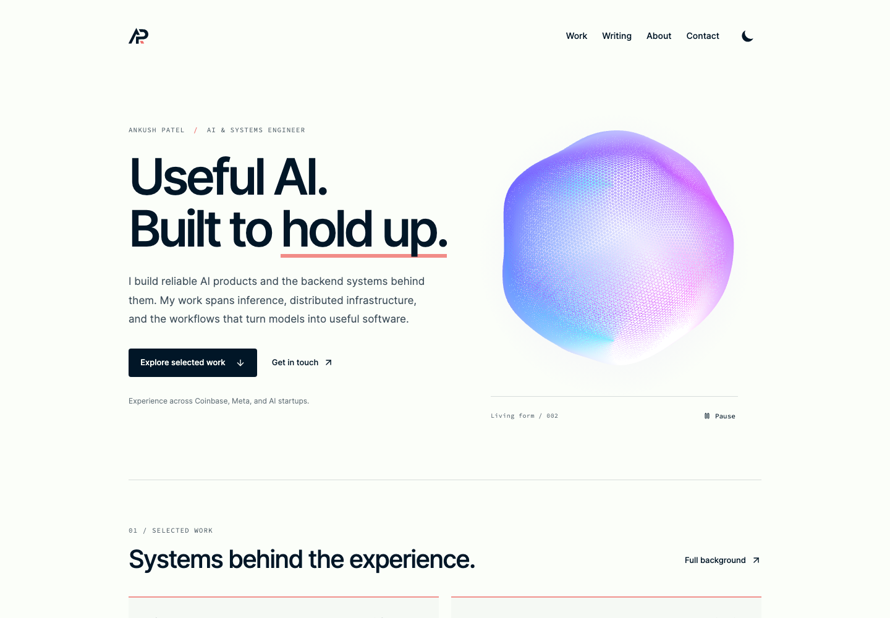

# Website v2 — issue #105

Date: 2026-10-10. Base: `46f1730` (main). Branch: `ap/feat-website-v2`.

## Intent and content provenance

The homepage now explains Ankush's specialty, shows two selected work summaries,
links three existing technical essays, and offers explicit work/contact paths.
The responsive hero pairs the introduction with a luminous blue/violet/cyan blob.

- Meta and Spice Cloud Labs summaries come from `data/authors/default.mdx`.
  They describe contributions without promoting the biography's self-reported
  metrics into new headline claims. Full case studies still need author-supplied
  decisions, constraints, and outcome evidence.
- The [UT Engineering Potify feature](https://tickle.utk.edu/news/ut-students-develop-app-aimed-at-warning-city-about-potholes/)
  names Ankush as a developer and describes work orders, mapping, and beta testing.
  It does not establish citywide deployment. Home and About use the supported
  development description rather than claiming municipal adoption.
- Blog URLs are unchanged. Work and Contact use homepage anchors, reachable from
  all primary navigation, including blog pages.
- No new dependencies, analytics providers, or hosting configuration were added.
  Professional-intent measurement remains a follow-up under existing issue #89.

## Visual research and decision

The original has a broadly rounded silhouette, continuous violet/blue/cyan/pink
color fields, and a luminous lower cusp. Its light theme uses a fine airy wireframe.
The later glossy experiment at `56cdf1f` retained the hues but introduced numerous
folds and white specular spots. That changed the material and weakened its identity.
Rendering benchmarks were not evidence that this visual change was better.

Primary creator references were researched before the next experiment:

| Reference                                                                                                               | What was actually inspected                                                                                                                                                                                                                                                                        | Applicable lesson                                                                                                                   |
| ----------------------------------------------------------------------------------------------------------------------- | -------------------------------------------------------------------------------------------------------------------------------------------------------------------------------------------------------------------------------------------------------------------------------------------------- | ----------------------------------------------------------------------------------------------------------------------------------- |
| [Mario Carrillo, Creative WebGL Blobs](https://tympanus.net/codrops/2021/01/26/twisted-colorful-spheres-with-three-js/) | Three frames of the creator's [published demo assets](https://github.com/codrops/WebGLBlobs), run locally because the live host presented a verification challenge. Rounded bodies carry coordinated twisting color ribbons.                                                                       | Coordinate shape and color motion. The ribbons themselves are busier than this site's original identity.                            |
| [Robert Aperios, Run Rob Run](https://www.runrobrun.com/)                                                               | Live scene across three frames; the first was loading, the next two showed changing broad folds, a consistent orange/clear material, and a localized hover grid. [Creator breakdown](https://tympanus.net/codrops/2026/08/20/run-rob-run-building-a-music-reactive-goo-with-three-js-and-webgpu/). | A coherent material and a subordinate interaction are more useful than stacking effects. Its glass/orange treatment is not adopted. |
| [Unseen Studio, Cellular](https://unseen.co/labs/cellular/)                                                             | Two live frames with pointer movement: cobalt/violet cells, pink field, depth through focus, and a coordinated opening following the pointer. [Creator breakdown](https://tympanus.net/codrops/2025/09/11/when-cells-collide-the-making-of-an-organic-particle-experiment-with-rapier-three-js/).  | A controlled graphic palette and one clear response can create depth without shiny reflections.                                     |

These are design interpretations from inspected examples, not universal rules of
what looks good. Liquid Raymarching's live demo remained behind a verification
challenge; it was read as a creator explanation but not claimed as visually verified.

A matched-camera study compared the original with a shallow rotating-noise field,
and that field plus a restrained twist, at 0/5/10/15/20/25 seconds in both themes.
The candidate also tested an antialiased triangular lattice. Dark color identity
survived, but the twist added little and the lattice looked coarser/heavier than
the original's fine veil. Those experiments were not adopted. The light comparison
changes geometry, line rendering, and lightness as well as deformation; it does
not isolate one variable.

[Interactive research study](./evidence/issue-105/blob-study.html) (download/open
in a browser; loads pinned Three.js from jsDelivr),
[dark at 0s](./evidence/issue-105/study-dark-0.png),
[dark at 15s](./evidence/issue-105/study-dark-15.png),
[light at 0s](./evidence/issue-105/study-light-0.png),
[light at 15s](./evidence/issue-105/study-light-15.png).

The selected revision preserves the original rather than declaring either study
a visual upgrade. It restores the original color shader, shallow deformation,
continuous rotation, and fine light-mode wireframe, gives the object more space
within the hero, and adds restrained spring-based pointer orientation/deformation.
Visual preference remains the author's decision.

## Current blob behavior

The material is the original UV color field, not a physically shaded plastic.
One GPU Perlin-noise field displaces the body with the original 0.15 amplitude.
Elapsed-time rotation preserves the original approximately 0.12 radians/second at
60Hz. Pointer influence adds at most 0.02 deformation amplitude and small weighted
tilt/yaw, with an exact damped spring carrying velocity between frames.

Dark solid geometry uses 16,820 triangles on desktop and 8,820 compact. Light mode
retains the original 48,020-triangle topology, rendered as 144,060 line segments,
because reducing that density visibly changed its character. Both are one draw
per frame, with no textures or postprocessing. A static CSS halo replaces the
original extra sprite draw. Triangle counts are a cost description, not a claim
that the design is better or universally faster.

The server-rendered SVG retains solid/mesh theme distinctions before JavaScript,
for reduced motion, and after graphics failures. The canvas replaces it only after
a successful render. Text and contact do not depend on it. Pause, offscreen, and
document-hidden states stop the frame loop. Theme changes reuse the renderer;
geometry is replaced/disposed only when theme/detail changes. DPR is capped at
2 desktop / 1.5 compact and adapts downward after sustained slow frames, with
cooldowns and slower recovery. Cancellable idle-time shader preparation avoids
the unmount/context-loss polling race found with `compileAsync`.

Technical references: [exact damped springs](https://www.ryanjuckett.com/damped-springs/),
[Three.js rendering on demand](https://threejs.org/manual/pages/rendering-on-demand.html),
and [responsive rendering](https://threejs.org/manual/pages/responsive.html).

## Validation

Passed locally:

- `npm run lint`
- `npm run typecheck`
- `npm run build` (41 routes)
- `npm run test` (28 tests)
- `npm run test:smoke:ci` (13 tests passed without retries)
- `HOME_VISUAL_HEALTH_URL=http://127.0.0.1:4175 npm run health:home-visual`

New smoke checks cover the work → essay → contact journey; real shader rendering;
pixel stability while paused and movement after resume; zero draw submissions while
paused/offscreen and resumed submissions when visible; renderer identity across
theme changes; reduced motion; 320px mobile navigation/overflow; WebGL creation
failure; real context loss; and useful content without JavaScript. WebGL tests
explicitly enable SwiftShader in the isolated headless test browser.

The health script now requires a visible initialized canvas or fallback instead of
merely collecting element counts. Its default local headless configuration used
the static fallback successfully. The local production server cannot serve Vercel's
`/_vercel/speed-insights/script.js`; this produces a known 404/MIME console message,
not a page runtime exception. The software-WebGL evidence captures had no page errors.

Inspected final light/dark desktop and mobile screenshots. The final 320px, 375px,
and 1440px captures have no horizontal overflow. Native Metal rendering was measured
on this Mac; actual phones, battery behavior, Safari, and field Core Web Vitals remain
unmeasured.

## Production-build comparison

A fresh local production build was captured before changes and again afterward.
Each run uses a fresh browser context, the same Chromium version, local HTTP,
software WebGL, and no CPU/network throttling. Three runs per viewport/theme.
The capture waits for network idle and another 1.5 seconds before reading buffered
PerformanceObserver entries. These are short local load measurements, not
Lighthouse scores or field performance; INP is not measured. Animation cadence is
measured separately below. Small millisecond differences should not be treated as improvements or
regressions in real-user experience.

| Viewport/theme | Before median FCP/LCP | After median FCP/LCP | After CLS, all runs |
| -------------- | --------------------: | -------------------: | ------------------: |
| 1440px light   |            72 / 72 ms |           68 / 68 ms |                   0 |
| 1440px dark    |            60 / 60 ms |           64 / 64 ms |                   0 |
| 375px light    |            60 / 60 ms |           64 / 64 ms |                   0 |
| 320px dark     |            56 / 56 ms |           64 / 64 ms |                   0 |

Same-origin resource transfer totals (excluding the navigation document) were
approximately 864 KB before and 868 KB after, including fonts and prefetched
resources. Reserving theme-control dimensions removed the hydration layout shift
seen in the initial v2 capture.

Reproduce against a local production server:

```sh
npm run build
npm run serve -- --hostname 127.0.0.1 --port 4175
# In another terminal, from the repository root:
node docs/perf/evidence/issue-105/capture.mjs after
```

The capture writes ignored artifacts under `output/website-v2/`. Retained data:
[before metrics](./evidence/issue-105/before-metrics.json) and
[after metrics](./evidence/issue-105/after-metrics.json).

## Current animation measurements

Chromium 145 on an Apple M2 Pro, using native Metal. Values below are medians
of the three per-run percentiles. Resolution stayed at its configured maximum
throughout all runs.

| Scenario              | Median p50 interval | Median p95 interval | Primitives per draw | Drawing buffer |
| --------------------- | ------------------: | ------------------: | ------------------: | -------------- |
| Dark desktop, idle    |              8.3 ms |              9.8 ms |    16,820 triangles | 952 × 952      |
| Dark desktop, pointer |              8.3 ms |              9.2 ms |    16,820 triangles | 952 × 952      |
| Dark compact, idle    |              8.3 ms |              9.2 ms |     8,820 triangles | 514 × 514      |
| Light desktop, idle   |              8.3 ms |              9.2 ms |       144,060 lines | 952 × 952      |
| Light compact, idle   |              8.3 ms |              9.1 ms |       144,060 lines | 514 × 514      |

One interval exceeded 50 ms across the three dark desktop idle runs; none did in
the other scenarios. This demonstrates smooth submission cadence on this machine,
not a universal frame-rate guarantee. [Current raw measurements](./evidence/issue-105/original-refined-metal.json).

The benchmark instruments the blob's draw submissions from the test browser;
it adds no application telemetry. Five scenarios cover dark desktop idle/pointer,
dark compact, and light desktop/compact. Each uses three requested ten-second
windows after warmup. The recorded observed span accounts for timer overrun.
Desktop is 1440×1000 and compact 375×812, at device DPR 2. These are intervals
between draw submissions, not GPU execution time or field performance.

Reproduce on a Mac with Metal support:

```sh
BLOB_PERF_BACKEND=metal node scripts/blob-performance-check.mjs original-refined-metal
```

The software backend remains available by omitting the environment variable.
[Earlier Metal baseline](./evidence/issue-105/contour-metal.json),
[rejected glossy experiment](./evidence/issue-105/revised-metal.json), and its
[software results](./evidence/issue-105/revised-software.json) are retained as
historical evidence. They do not describe the current shader. The glossy experiment
showed a desktop software-renderer regression despite its lower triangle count;
that result helped demonstrate why counts alone are insufficient.

## Visual evidence

Before, dark desktop:



After, dark desktop:



After, light desktop:



[Full mobile page](./evidence/issue-105/after-mobile-light.png)

## Risk and rollback

Medium risk: new visual art direction and WebGL lifecycle behavior. Server-rendered
content and a static visual cover failures. Existing routes, APIs, and data remain
compatible. Revert the PR to restore the previous presentation; no migration or
credential changes are involved. This change does not merge or deploy production.
